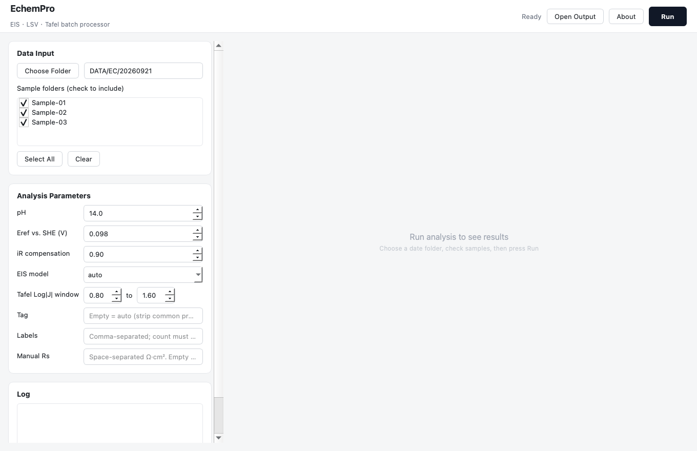

# EchemPro

**面向碱性析氢（HER）研究的电化学数据批处理工具。** 把 EIS、LSV、Tafel 的重复处理从零散脚本和手工表格收拢到一个界面里：选一个日期文件夹，勾选样品，点一次 Run。

EchemPro 读取 CS Studio 导出的实验数据，批量完成等效电路拟合、RHE 电位换算、iR 补偿和 Tafel 拟合，并生成跨样品对比图。图形界面只负责选数据、填参数、看日志和预览结果；真正的计算由命令行入口与 GUI 共用的同一套内核完成，保证两边输出一致、论文数据可追溯。



> 截图中使用通用占位样品名（Sample-01/02/03），不包含真实实验数据。

## 功能

- **一键批处理**：选定日期文件夹后自动列出样品子文件夹，勾选参与处理的样品，一次完成 EIS 拟合、LSV 校正和 Tafel 对比。
- **EIS 等效电路拟合**：比例加权（1/|Z|）最小二乘。`auto` 模式优先双时间常数 `Rs + L + (R1‖CPE1) + (R2‖CPE2)`，只有当 GoF 相对改善超过 20% 时才采用双弧模型，否则回退单 Randles `Rs + (Rct‖CPE)`。
- **LSV 校正**：自动识别回程段，换算到 RHE 标度，并按比例做 iR 补偿；Rs 默认取同样品 EIS 拟合值，也可手动指定。
- **Tafel 分析**：在指定的 Log|J| 窗口内做线性拟合，输出每个样品的 Tafel 斜率。
- **结果即时可见**：后台线程执行，日志实时滚动；完成后在应用内直接预览 LSV、Tafel、Nyquist 对比图和单样品图。
- **附带分析工具**：DRT（Tikhonov + NNLS）、单 EIS 文件三图、扫速 CV 最后一圈提取与 H 脱附峰分析。

## 处理流程

```
日期文件夹/
└── 样品文件夹/
    ├── *-EIS.txt        → 等效电路拟合 → Rs / Rct / R_pol / GoF
    └── *-LSV.txt        → 取回程 → RHE 换算 + iR 补偿 → *_RHE.csv
                                             ↓
                              Tafel 窗口线性拟合 → 斜率
                                             ↓
        跨样品对比图（LSV / Tafel / Nyquist）+ EIS 汇总 CSV + 单样品图
```

## 快速开始

### 从源码运行

需要 Python 3.14（开发与打包验证版本为 3.14.3，其他版本未验证）。

```bash
git clone https://github.com/PhDStone/EchemPro.git
cd EchemPro

python3 -m venv .venv
source .venv/bin/activate
pip install -r requirements.txt

python EchemPro.py
```

### 构建 macOS 应用

```bash
# 使用当前虚拟环境
PYTHON=.venv/bin/python ./build.sh
```

`build.sh` 默认复用同级 `RuHeterojunctionHER/.venv`（作者本地工作区布局），在独立克隆中请用上面的 `PYTHON=` 形式。构建完成后，`EchemPro.app` 会移动到仓库的**上一级目录**；如果上一级已有同名应用，会先改名为带时间戳的 `.bak` 再替换。中间产物 `build/` 和 `dist/` 已在 `.gitignore` 中排除。

当前打包版只针对 **macOS Apple Silicon（arm64）**，使用 ad-hoc 签名。首次从 Finder 打开时如被 Gatekeeper 拦截，右键 → Open 即可。

### 界面使用步骤

1. **Choose Folder** 选择日期文件夹（如 `DATA/EC/20260921`），也可以直接把路径粘进输入框后回车。
2. 在 **Sample folders** 列表里勾选参与处理的样品，默认全选。
3. 按需修改 **Analysis Parameters**（pH、参比电位、iR 补偿比例、EIS 模型、Tafel 窗口等）。
4. 点击 **Run**。处理期间界面不阻塞，日志实时显示；出错会弹出提示。
5. 完成后右侧显示对比图卡片和单样品图标签页；**Open Output** 在 Finder 中打开输出目录。

## 输入数据

数据按日期文件夹组织，每个样品一个子文件夹：

```
DATA/EC/20260921/
├── Ru_NiP_annealing/
│   ├── init-EIS.txt
│   ├── init-LSV.txt
│   └── init-CV.txt
└── another_sample/
    ├── ...
```

文件按名称后缀 `-EIS` / `-LSV` 识别技术类型；同一技术优先用 `.txt`（CS Studio 导出），其次 `.csv`（galvani 转出）与 `.mpr`（BioLogic 原始）。同类有多个文件时取排序后的第一个，以 `._` 开头的 macOS AppleDouble 文件会自动跳过。

| 数据 | 格式 | 说明 |
|---|---|---|
| `*-LSV.txt` / `*-CV.txt` | CS Studio 文本导出 | 首行 `CSStudioFile` 元数据，tab 分隔，列 `E(V) / i(A/cm²) / T(s)`；电流已是电流密度（几何面积 1 cm²） |
| `*-EIS.txt` | CS Studio 文本导出 | 列 `Freq(Hz) / Z'(Ohm.cm²) / Z''(Ohm.cm²)`；Z'' 电容性为负，按表头名匹配列，不依赖列序 |
| `*.csv` | galvani 转出的 PEIS / 扫描 CSV | EIS 用于 DRT 时要求 3 列（频率、Z'、Z''），无表头 |
| `*.mpr` | BioLogic EC-Lab 原始文件 | 命令行在安装 `galvani` 后可自动转换；打包版未内置 galvani，遇到 .mpr 只会提示转换方法 |

## 参数说明

| 参数 | 默认值 | 说明 |
|---|---|---|
| pH | 14.0 | 电解液 pH，用于 RHE 换算；1 M KOH 取 14 |
| Eref vs. SHE | 0.098 V | 参比电极相对 SHE 的电位；Hg/HgO 取 0.098 |
| iR compensation | 0.90 | iR 补偿比例，1.0 表示完全补偿 |
| EIS model | `auto` | `auto` / `single` / `double`；`auto` 按 GoF 改善阈值选择 |
| Tafel Log\|J\| window | 0.8 – 1.6 | 拟合窗口，J 的单位是 mA·cm⁻²；窗口内少于 5 个点时跳过该样品 |
| Tag | 自动 | 输出版本前缀；留空时取样品名去掉公共前缀后用 `_vs_` 连接 |
| Labels | 文件夹名 | 图例显示名，逗号分隔，数量须与勾选样品一致 |
| Manual Rs | EIS 拟合值 | 手动指定各样品 Rs（Ω·cm²，空格分隔），跳过 EIS 拟合取值 |

## 输出物

所有结果写入所选日期文件夹（单样品图写入对应样品文件夹）：

| 文件 | 内容 |
|---|---|
| `EIS_summary_<tag>.csv` | 各样品的模型、Rs、R1/R2、R_pol、GoF |
| `Nyquist_comparison_<tag>.png` | 跨样品 Nyquist 对比（实测点 + 拟合线） |
| `LSV_comparison_<tag>.png` | 跨样品 LSV 对比（RHE + iR 补偿后） |
| `Tafel_comparison_<tag>.png` | 跨样品 Tafel 对比与斜率标注 |
| `<stem>_RHE.csv` | 逐样品校正后的 LSV 数据 |
| `<stem>_Nyquist.png` / `<stem>_Bode.png` | 单样品 EIS 图（实测点 + 拟合线） |

图统一为 300 DPI。跨样品对比图和 `EIS_summary` 通过 `tag` 区分不同批次；逐样品文件（`*_RHE.csv`、`*_Nyquist.png`、`*_Bode.png`）按原文件名写在样品文件夹里，重跑会覆盖。

> 注意：校正后 CSV 的电位列名固定为 `E_RHE_iR90/V`，即使把补偿比例改成 90% 以外的值，列名也不会变。

## 命令行工具

四个入口都位于仓库根目录，参数中的路径按实际数据位置填写：

```bash
# 主流程：EIS + LSV + Tafel，等价于 GUI 的一次 Run
python echem_process.py DATA/EC/20260921 Sample-01 Sample-02 --tag run1

# 单文件 DRT（Tikhonov + NNLS；默认 L-curve 自动选 λ）
python drt_analysis.py DATA/EC/20260921/Sample-01/init-EIS.txt --lambda 1e-2

# 单 EIS 文件：Nyquist / Bode / DRT 三图
python peis_separate_plots.py DATA/EC/20260921/Sample-01/init-EIS.txt

# 扫速 CV：提取最后一圈，并做 H 脱附峰 Ep-扫速分析
python extract_scanrate_cv.py --date 20260921 --sample Sample-01 \
    --files 20 40 60 80 100
```

> 扫速数据的目录约定是 `DATA/EC/<date>/<sample>-扫速/<rate>.txt`；`--sample` 填基础样品名（不含 `-扫速`）。

`echem_process.py` 的完整参数可用 `--help` 查看。

## 项目结构

```
EchemPro/
├── EchemPro.py               # PyQt5 界面：MainWindow + PipelineThread
├── echem_process.py          # 计算内核 process() + 命令行入口
├── drt_analysis.py           # DRT 反演（Tikhonov + NNLS）
├── peis_separate_plots.py    # 单 EIS 三图，复用内核与 DRT
├── extract_scanrate_cv.py    # 扫速 CV 最后一圈 + Ep-扫速
├── requirements.txt          # 运行时依赖（版本同打包环境）
├── build.sh                  # 一键重建 macOS 应用
├── EchemPro.spec             # PyInstaller 配置
├── docs/screenshot.png       # 界面截图
└── PRD.md                    # 产品需求、架构与验收标准
```

## 计算约定

```text
E_RHE = E_measured + 0.0592 × pH + E_ref − i × Rs × (iR ratio)
```

- `i` 的单位是 A·cm⁻²，`Rs` 的单位是 Ω·cm²，两者直接相乘得到 iR 压降；EIS 阻抗本身已是面积归一化值。
- GoF 定义为拟合残差的相对均方根，按百分比输出：`100 × RMS(|Z_fit − Z_meas| / |Z_meas|)`。
- Tafel 拟合使用过电位 η = −E_RHE 对 `log10(|J|)` 作图，斜率乘 1000 后以 mV·dec⁻¹ 输出。

## 已知限制

- 打包版仅支持 macOS Apple Silicon；源码本身基于 PyQt5，理论上可跨平台，但未在 Windows / Linux 上验证。
- `.mpr` 原生解析未打进 app：先在 EC-Lab / CS Studio 里导出 txt，或安装 `galvani` 后用命令行处理。
- app 是冻结产物，改完源码需要重新运行 `./build.sh` 才会生效。
- `auto` 模式对少数谱形可能选错模型，必要时用 `single` / `double` 强制指定。
- ad-hoc 签名意味着拷贝到其他 Mac 后首次需右键打开；如需广泛分发，需要 Apple 开发者签名与公证。

## 相关文档

更完整的产品定义、功能验收标准和版本路线图见 [PRD.md](PRD.md)。
